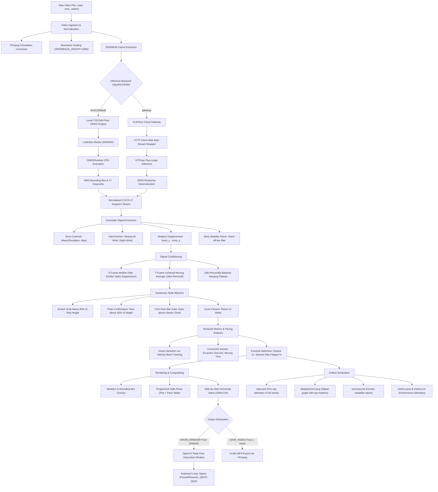

# Motion-Lens: Chin-Ups Biomechanical Analysis Engine
### End-to-End Technical Architecture, Kinematics, Signal Processing & Operational Manual

---

## 1. Executive Summary & Biomechanical Scope

**Motion-Lens: Chin-Ups** is an automated, computer-vision-based biomechanical telemetry engine engineered to analyze the **chin-up** exercise from pre-recorded video footage. 

### Biomechanical Profile of the Chin-Up
In strength and conditioning, the chin-up is characterized by:
- **Grip Orientation**: Underhand (**supinated**), where the palmar aspect of the hands faces toward the athlete's face.
- **Primary Kinematics**: Glenohumeral shoulder extension and adduction coupled with elbow flexion in the sagittal and frontal planes.
- **Muscular Engagement**: Increased recruitment of the **biceps brachii** and **brachialis** alongside the **latissimus dorsi** and **teres major**.
- **Critical Performance Milestone**: Achieving full chin-over-bar clearance at the peak of concentric contraction ($y_{\text{chin}} < y_{\text{bar}}$) and controlled eccentric descent into full elbow extension.

### Core System Objectives
1. **Zero-Invasive Video Analysis**: Operates directly on standard RGB video (`.mp4`, `.mov`, `.webm`) recorded via mobile phones or gym cameras without physical sensors or markers.
2. **Dual-Engine Pose Estimation**:
   - **Local Offline Engine**: Embedded `yolov8n-pose.onnx` inference running locally via ONNX Runtime (zero cloud cost, zero latency penalty, complete privacy).
   - **Cloud Gateway Engine**: High-fidelity `usyd-community/vitpose-plus-large` via the VLM Run OpenAI-compatible API gateway.
3. **Signal Kinematics & Noise Rejection**: Hand-anchored relative coordinate frame that eliminates handheld camera motion artifacts, paired with cascaded median and moving-average filters.
4. **Hysteresis State Machine**: Dual-threshold state machine that eliminates edge jitter and false double-counting.
5. **Concentric & Eccentric Temporal Telemetry**: Measures precise phase durations (concentric ascent, eccentric descent, moving duration, and whole-cycle timing) and tracks muscular fatigue degradation across a set.
6. **Real-Time Interactive Rendering**: Live OpenCV GUI display window (`cv2.imshow`) rendering skeleton overlays and progressive performance HUD at native video framerate without mandatory disk I/O.

---

## 2. End-to-End Architectural Pipeline

The diagram below outlines the sequential lifecycle of a video processed through the chin-up analysis pipeline:



---

## 3. Mathematical & Kinematic Formulations

### 3.1 Hand-Anchored Coordinate System
Standard image coordinate spaces define $(0, 0)$ at the top-left corner, meaning vertical coordinate values ($y$) increase downward toward the floor. In a workout video, tracking raw pixel coordinates fails whenever the camera shakes, tilts, or is handheld.

To achieve camera-invariant displacement, Motion-Lens constructs a relative coordinate frame where the pull-up/chin-up bar serves as the spatial reference origin:

1. **Torso Centroid** $y_{\text{torso}}(t)$:
   $$y_{\text{torso}}(t) = \frac{y_{\text{left\_shoulder}}(t) + y_{\text{right\_shoulder}}(t) + y_{\text{left\_hip}}(t) + y_{\text{right\_hip}}(t)}{4}$$
   *Averaging four bilateral torso joints cancels single-joint estimation jitter and prevents body sway or leg kicking from distorting the trunk center.*

2. **Hand Anchor** $y_{\text{hands}}(t)$:
   $$y_{\text{hands}}(t) = \frac{y_{\text{left\_wrist}}(t) + y_{\text{right\_wrist}}(t)}{2}$$

3. **Relative Vertical Displacement** $s_{\text{raw}}(t)$:
   $$s_{\text{raw}}(t) = y_{\text{hands}}(t) - y_{\text{torso}}(t)$$
   Because $y$ grows downward, as the athlete pulls themselves up, the torso coordinate $y_{\text{torso}}$ decreases, causing $s_{\text{raw}}(t)$ to **rise positively**. When the athlete hangs at full arm extension, the torso is farthest from the hands, establishing the minimum displacement value.

4. **Wrist Drift Gate (Hands-on-Bar Filter)**:
   The bar is assumed to be stationary. If an athlete steps off the bar, drops down, or adjusts their grip, the vertical position of the wrists will shift. If wrist displacement exceeds `HAND_OFF_BAR_TOLERANCE` ($\Delta y_{\text{wrist}} > 0.05$ frame height), the frame is flagged as invalid and excluded from rep counting.

---

### 3.2 Cascaded Signal Conditioning
Raw keypoint coordinates from frame-by-frame deep learning detectors contain two distinct noise artifacts:
1. **High-Frequency Spikes**: Single-frame detector dropouts or keypoint misassignments.
2. **Keypoint Jitter**: Zero-mean Gaussian jitter between adjacent frames.

Motion-Lens applies a two-stage filter:

```
s_raw(t) ──> [ 5-Frame Median Filter ] ──> s_med(t) ──> [ 7-Frame Centered Moving Average ] ──> s(t)
```

1. **Median Filter (Spike Rejection)**:
   $$s_{\text{med}}(t) = \text{median}\left( \{s_{\text{raw}}(t - 2), s_{\text{raw}}(t - 1), s_{\text{raw}}(t), s_{\text{raw}}(t + 1), s_{\text{raw}}(t + 2)\} \right)$$
   Removes impulse noise without blurring edge boundaries or shifting peak timing.

2. **Centered Moving Average (Jitter Smoothing)**:
   $$s(t) = \frac{1}{2m + 1} \sum_{i=-m}^{m} s_{\text{med}}(t + i) \quad \text{where } m = 3 \text{ (window of 7 frames)}$$
   Suppresses high-frequency jitter while maintaining symmetric phase alignment (zero phase lag).

3. **Baseline Zero Calibration**:
   Instead of using the global minimum (which is vulnerable to a single anomalous deep drop), Motion-Lens computes the baseline $s_{\text{baseline}}$ as the **10th percentile** ($P_{10}$) of the smoothed signal:
   $$s_{\text{baseline}} = \text{Percentile}_{10}\left( \{s(t)\}_{t=1}^N \right)$$
   This reliably isolates the flat dead-hang plateau. The rep amplitude $A$ is defined as:
   $$A = \max_t(s(t)) - s_{\text{baseline}}$$

---

### 3.3 Hysteresis Rep Segmentation State Machine

To prevent false counting caused by athlete pauses, bar oscillations, or mid-rep hesitation, Motion-Lens utilizes a **dual-threshold hysteresis state machine**:

```
        s(t) >= s_baseline + 0.60 * A  AND  m_head(t) > 0
      ┌──────────────────────────────────────────────────┐
      │                                                  ▼
┌───────────┐                                      ┌───────────┐
│   ARMED   │                                      │ CONFIRMED │
│  (Valley) │                                      │  (Peak)   │
└───────────┘                                      └───────────┘
      ▲                                                  │
      │         s(t) <= s_baseline + 0.30 * A            │
      └──────────────────────────────────────────────────┘
```

1. **Armed State**: The detector arms when the displacement falls below the reset threshold:
   $$s(t) \le s_{\text{baseline}} + \alpha_{\text{reset}} \cdot A \quad (\alpha_{\text{reset}} = 0.30)$$
2. **Confirmed State**: A repetition is confirmed when the displacement rises past the peak threshold:
   $$s(t) \ge s_{\text{baseline}} + \alpha_{\text{peak}} \cdot A \quad (\alpha_{\text{peak}} = 0.60)$$
   **AND** meets the Chin-Over-Bar condition.
3. **Chin-Over-Bar Gate**:
   A chin-up is biologically defined by bringing the chin over the horizontal plane of the bar. Because facial keypoints locate eyes and nose directly:
   $$y_{\text{eyes}}(t) = \min\left( y_{\text{left\_eye}}(t), y_{\text{right\_eye}}(t) \right)$$
   $$m_{\text{head}}(t) = y_{\text{hands}}(t) - y_{\text{eyes}}(t)$$
   Since $y$ decreases upward, the condition $y_{\text{eyes}} < y_{\text{hands}}$ produces $m_{\text{head}}(t) > 0$. If an athlete reaches 60% displacement but fails to clear their eyes above their hands, the peak is rejected.

---

### 3.4 Temporal Kinematics & Velocity Back-Tracking

Each confirmed repetition is decomposed into granular timing phases:

```
Displacement s(t)
    ^                      Peak (t_peak)
    |                         /\
    |                        /  \
    |                       /    \
    |                      /      \
    |      Onset (t_onset)/        \  End / Valley (t_end)
    |-------------*------/          \_______
    |            /
    |  Valley   /
    |__*_______/
    +----------------------------------------> Time (s)
       |<------- Ascent ---------->|
       |         |<-- Moving ----->|
       |<------------------ Total Cycle ---->|
```

1. **Concentric Ascent Time**:
   $$T_{\text{ascent}} = t_{\text{peak}} - t_{\text{valley}}$$
2. **Eccentric Descent Time**:
   $$T_{\text{descent}} = t_{\text{end}} - t_{\text{peak}}$$
3. **Total Cycle Duration**:
   $$T_{\text{total}} = t_{\text{end}} - t_{\text{valley}}$$
4. **Active Moving Time ($T_{\text{moving}}$) via Velocity Back-Tracking**:
   Athletes frequently hang motionless at the bottom before initiating a pull. Including this idle hang inflates rep duration. Motion-Lens isolates active muscle contraction:
   - Calculate instantaneous vertical velocity: $v(t) = \frac{ds}{dt}$.
   - Identify maximum upward concentric velocity $v_{\max} = \max_{t \in [t_{\text{valley}}, t_{\text{peak}}]} v(t)$.
   - Walk backward in time from $t(v_{\max})$ until the velocity drops below 10% of maximum:
     $$v(t_{\text{onset}}) \le 0.10 \cdot v_{\max}$$
   - Compute moving duration:
     $$T_{\text{moving}} = t_{\text{peak}} - t_{\text{onset}}$$

---

### 3.5 Pacing & Muscular Fatigue Analysis
Across a set of chin-ups, fatigue produces progressive velocity loss. Motion-Lens analyzes the vector of rep durations $\{T_1, T_2, \dots, T_K\}$:

1. **Fastest Rep Selection**:
   $$i_{\text{fast}} = \min \left\{ i \mid T_i = \min(T) \right\}$$
   *Picks the earliest occurrence to capture peak explosive power prior to fatigue onset.*
2. **Slowest Rep Selection**:
   $$i_{\text{slow}} = \max \left\{ i \mid T_i = \max(T) \right\}$$
   *Picks the latest occurrence to capture end-of-set muscular exhaustion.*
3. **Fatigue Degradation Percentage**:
   $$\Delta_{\text{fatigue}} = \frac{T_{\text{slowest}} - T_{\text{fastest}}}{T_{\text{fastest}}} \times 100\%$$
   A high $\Delta_{\text{fatigue}}$ (e.g., $+45\%$) indicates severe neuromuscular fatigue.

---

## 4. Pose Estimation Engines

Motion-Lens supports two interchangeable pose estimation backends configured via `cfg.BACKEND`:

```
                    ┌──────────────────────────────┐
                    │    Normalized Frame Tensor   │
                    └──────────────┬───────────────┘
                                   │
                 ┌─────────────────┴─────────────────┐
                 ▼                                   ▼
   [ BACKEND = "local" ]                   [ BACKEND = "gateway" ]
   YOLOv8n-Pose (ONNX)                     ViTPose-Plus-Large
   - Local CPU/GPU inference               - Cloud API (VLM Run)
   - 640x640 Letterbox                     - Vision Transformer backbone
   - Zero API cost                         - High precision keypoints
   - ~25-35 FPS on CPU                     - Multi-person tracking
```

### 4.1 Local Offline Engine (`models/yolov8n-pose.onnx`)
- **Architecture**: YOLOv8n-pose deep neural network exported to ONNX format.
- **Input Geometry**: $640 \times 640 \times 3$ RGB tensor normalized to $[0.0, 1.0]$.
- **Aspect Ratio Handling**: Bilinear resize with letterbox padding (`114` gray border) maintaining original video aspect ratio.
- **Output Tensor**: Shape $(1, 56, 8400)$ transposed to $(8400, 56)$, containing:
  - 4 bounding box dimensions $(cx, cy, w, h)$.
  - 1 box objectness confidence score.
  - $17 \times 3 = 51$ keypoint coordinates $(x_k, y_k, \text{conf}_k)$.
- **Non-Maximum Suppression (NMS)**:
  - Confidence Threshold: $0.35$
  - IoU Suppression Threshold: $0.45$
  - Handled via `cv2.dnn.NMSBoxes`.
- **Runtime Performance**: ~25–35 FPS on modern x86/ARM CPUs without requiring a dedicated GPU.

### 4.2 Cloud Gateway Engine (`usyd-community/vitpose-plus-large`)
- **Architecture**: Vision Transformer (ViT-Large) backbone with classic pose estimation head.
- **API Protocol**: OpenAI-compatible REST API gateway (`POST https://gateway.vlm.run/v1/openai/chat/completions`).
- **Telemetry Payload**: Structured JSON schema following `vid.pose.kpts` protocol.
- **Client-Side Socket Timing**: Wrapped HTTP byte stream decomposes response time into network upload, cloud server processing, and client download.

### 4.3 Keypoint Mapping (COCO-17 Schema)
Both backends output the standardized 17-point COCO human pose topology:

| Index | Keypoint Name | Anatomical Location | Usage in Chin-Ups |
|:---:|---|---|---|
| `0` | `nose` | Facial midline | Facial centroid reference |
| `1`, `2` | `left_eye`, `right_eye` | Orbital region | **Chin-over-bar clearance validation** |
| `3`, `4` | `left_ear`, `right_ear` | Temporal region | Lateral head balance |
| `5`, `6` | `left_shoulder`, `right_shoulder` | Acromioclavicular joint | **Upper torso centroid reference** |
| `7`, `8` | `left_elbow`, `right_elbow` | Olecranon process | Elbow angle tracking |
| `9`, `10` | `left_wrist`, `right_wrist` | Radiocarpal joint | **Hand bar anchor reference** |
| `11`, `12` | `left_hip`, `right_hip` | Greater trochanter / Pelvis | **Lower torso centroid reference** |
| `13`, `14` | `left_knee`, `right_knee` | Patella / Femorotibial joint | Lower body stability check |
| `15`, `16` | `left_ankle`, `right_ankle` | Lateral malleolus | Ground clearance check |

---

## 5. Telemetry HUD & Visual Compositing

Motion-Lens composites a side-by-side $2560 \times 720$ canvas combining the annotated video stream with a progressive statistics panel:

```
┌──────────────────────────────────────┬──────────────────────────────────────┐
│                                      │ Chin-ups: 6                          │
│                                      │ Avg Duration: 1.03s                  │
│                                      │                                      │
│                                      │          Rep Duration (s)            │
│                                      │   1.2 ┤            ● 1.17  ● 1.17    │
│                                      │       │                   (slowest)  │
│                                      │   1.0 ┤         ● 1.03         ● 1.03│
│                                      │       │      ● 0.93                  │
│                                      │   0.8 ┤ ● 0.87                       │
│                                      │       │(fastest)                     │
│                                      │       └─────┬─────┬─────┬─────┬────> │
│                                      │             1     2     3     4   rep│
│                                      │                                      │
│                                      │ Fastest: rep 1 (0.87s)               │
│                                      │ Slowest: rep 5 (1.17s)               │
│                                      │ 35% slower from rep 1 to rep 5       │
│                                      │                      Jeremy Park     │
└──────────────────────────────────────┴──────────────────────────────────────┘
            Video Stream (1280x720)                 Stats Panel (1280x720)
```

### Rendering Specifications
- **Progressive Disclosure (`PANEL_PROGRESSIVE = True`)**: The panel updates state-by-state as each rep is completed. Rep dots and connecting line segments illuminate in real time rather than appearing all at once.
- **Fixed-Scale Axes**: Matplotlib axes are pre-calculated against the entire set's maximum and minimum durations before rendering begins. This prevents the graph from shifting, bouncing, or rescale-jittering during video playback.
- **Color Palette Tokens**:
  - Background: Dark charcoal (`#14161a`)
  - Foreground Text: Crisp white (`#f2f4f7`)
  - Grid & Border: Subtle slate (`#2b3038`)
  - Accent / Trajectory: Neon Blue (`#28a0ff`)
  - Fastest Rep Dot: Vibrant Green (`#51cf66`)
  - Slowest Rep Dot: Amber Orange (`#ff922b`)

---

## 6. Real-Time Interactive GUI Window

Rather than forcing users to wait for slow video encoding and clogging hard drives with multi-gigabyte video files, Motion-Lens streams the live composited output directly to an interactive OpenCV window.

### Playback Controls
| Keybinding | Action | Description |
|:---:|:---:|---|
| **`Space`** | **Pause / Play** | Freezes video playback and pose telemetry. Press `Space` again to resume. |
| **`Q`** | **Quit / Exit** | Immediately terminates the window, closes OpenCV handles, and exits cleanly. |
| **`ESC`** | **Quit / Exit** | Same as `Q`. |

### Timing & Synchronization Loop
The window display executes inside `src/render.py` using frame-accurate clock synchronization:
```python
delay_ms = max(1, int(1000 / info.fps))
cv2.imshow(window_name, combined_frame)
key = cv2.waitKey(delay_ms) & 0xFF
```
This guarantees that a 30 FPS video plays back at exactly 30 FPS (33 ms per frame), preserving real-world biomechanical velocity.

---

## 7. Exhaustive Configuration Reference (`config.py`)

Every operational knob in `chin_ups/config.py` is documented below:

| Parameter | Type | Default | Description |
|---|:---:|:---:|---|
| `INPUT_VIDEO` | `Path` | `data/input/chin_ups.mov` | Path to the default input video clip. |
| `INFERENCE_HEIGHT` | `int` | `1080` | Vertical resolution in pixels fed into the pose detector. |
| `EXPORT_HEIGHT` | `int` | `1080` | Vertical resolution of the output video canvas. |
| `TRIM_SECONDS` | `float \| None` | `None` | If set (e.g. `5.0`), limits analysis to the first $N$ seconds. |
| `CONVERT_CRF` | `int` | `23` | FFmpeg constant rate factor for intermediate H.264 cache videos. |
| `FORCE_RECONVERT` | `bool` | `False` | Forces FFmpeg re-encoding even if a cached file exists. |
| `REUSE_POSES` | `bool` | `False` | Forces reuse of cached JSON poses without invoking the model. |
| `BACKEND` | `str` | `"local"` | `"local"` (offline YOLOv8 ONNX) or `"gateway"` (cloud ViTPose). |
| `LOCAL_MODEL_PATH` | `Path` | `models/yolov8n-pose.onnx` | Filesystem path to the local ONNX weights file. |
| `MODEL` | `str` | `"vitpose-plus-large"` | Cloud model identifier when using gateway backend. |
| `GATEWAY_BASE_URL` | `str` | `https://gateway.vlm.run/v1/openai` | API endpoint for the cloud gateway. |
| `REQUEST_TIMEOUT` | `float` | `1800.0` | Network socket timeout in seconds. |
| `SHOW_WINDOW` | `bool` | `True` | Opens real-time interactive OpenCV display window. |
| `SAVE_VIDEO` | `bool` | `False` | When `True`, renders and saves H.264 `.mp4` to `data/output/`. |
| `WINDOW_WIDTH` | `int` | `1280` | Default width of the interactive GUI playback window. |
| `COUNT_REPS` | `bool` | `True` | Enables the kinematic rep segmentation engine. |
| `TORSO_JOINTS` | `tuple` | `("l_sh", "r_sh", "l_hip", "r_hip")` | Keypoints averaged to compute the torso centroid. |
| `HAND_JOINTS` | `tuple` | `("l_wrist", "r_wrist")` | Keypoints averaged to establish the bar anchor. |
| `HEAD_JOINTS` | `tuple` | `("l_eye", "r_eye")` | Keypoints used for chin-over-bar clearance checks. |
| `REFERENCE_TO_HANDS` | `bool` | `True` | Measures torso displacement relative to hands (`False` uses frame). |
| `HAND_OFF_BAR_TOLERANCE`| `float` | `0.05` | Max vertical wrist drift before discarding frame as "off bar". |
| `SMOOTH_MEDIAN_FRAMES` | `int` | `5` | Window size for the median outlier rejection filter. |
| `SMOOTH_MEAN_FRAMES` | `int` | `7` | Window size for the centered moving average filter. |
| `BASELINE_PERCENTILE` | `float` | `10` | Signal percentile defining the dead-hang zero baseline. |
| `REP_PEAK_FRACTION` | `float` | `0.60` | Signal fraction required to confirm a repetition peak. |
| `REP_RESET_FRACTION` | `float` | `0.30` | Signal fraction required to reset the hysteresis state machine. |
| `REQUIRE_HEAD_ABOVE_HANDS`| `bool` | `True` | Requires eyes above hands ($m_{\text{head}} > 0$) to validate rep. |
| `REP_METRIC` | `str` | `"moving"` | Reported rep timing: `"moving"`, `"ascent"`, or `"total"`. |
| `REP_ONSET_METHOD` | `str` | `"velocity"` | Algorithm for onset detection: `"velocity"` or `"threshold"`. |
| `REP_ONSET_VELOCITY_FRACTION`| `float`| `0.10` | Velocity threshold fraction for onset back-tracking. |
| `SIDE_PANEL` | `bool` | `True` | Generates side-by-side telemetry HUD panel. |
| `PANEL_PROGRESSIVE` | `bool` | `True` | Reveals rep graph progressive frame-by-frame. |
| `PANEL_PLOT_SCALE` | `float` | `0.95` | Fraction of panel allocated to the duration scatter plot. |
| `REP_LABEL` | `str` | `"Chin-ups"` | Header label displayed on the HUD panel. |
| `CREDIT` | `list` | `[]` | Watermark credits rendered in the panel corner. |

---

## 8. Command-Line Interface (CLI) Manual

Run `main.py` directly from the `chin_ups` directory:

```bash
cd chin_ups
../.venv/bin/python main.py [OPTIONS] [VIDEO_PATH]
```

### CLI Arguments & Options
| Flag | Arguments | Default | Description |
|---|:---:|:---:|---|
| `video` | Positional path | `config.py` | Path to a specific video clip to process. |
| `--show` | None | `True` | Enables interactive real-time window playback. |
| `--no-show` | None | - | Headless execution without GUI display window. |
| `--save` | None | `False` | Encodes and saves the rendered `.mp4` video to `data/output/`. |
| `--no-save` | None | `True` | Skips heavy video file rendering to conserve disk storage. |
| `--local` | None | `True` | Uses the local offline YOLOv8-pose ONNX engine. |
| `--gateway` | None | - | Uses the cloud VLM Run ViTPose gateway. |
| `--height` | `PX` or `full` | `1080` | Overrides output video height resolution. |
| `--trim` | `SECONDS` | `None` | Truncates analysis to the first $N$ seconds for rapid debugging. |
| `--li` | `TEXT` | `None` | Overlays LinkedIn credit text on the video HUD. |
| `--x` | `HANDLE` | `None` | Overlays X (Twitter) handle credit on the video HUD. |
| `--ig` | `HANDLE` | `None` | Overlays Instagram handle credit on the video HUD. |
| `--no-credit` | None | - | Suppresses all credit text watermarks. |

### Execution Examples
```bash
# 1. Run default clip with live real-time interactive playback:
../.venv/bin/python main.py

# 2. Run a specific custom chin-up video:
../.venv/bin/python main.py /path/to/my_workout_clip.mp4

# 3. Run and export the rendered MP4 video file to disk:
../.venv/bin/python main.py /path/to/my_workout_clip.mp4 --save

# 4. Quick 4-second test without opening a display window:
../.venv/bin/python main.py data/input/sample_set_1.mp4 --trim 4 --no-show
```

---

## 9. Output Directory & Data Schemas

Every execution creates an isolated, timestamped directory under `chin_ups/data/output/YYYYMMDD-HHMMSS/`:

```
data/output/20261026-102025/
├── displacement.png         # Publication-ready displacement & head-margin plot
├── reps.json                # Structured kinematic telemetry and per-rep numbers
├── summary.txt              # Formatted human-readable rep report
├── poses.json               # Raw COCO-17 keypoint time-series
├── metrics.json             # Throughput, latency, and system performance telemetry
├── metrics.txt              # Formatted performance benchmark summary
├── run.json                 # Complete configuration snapshot and environment metadata
└── <clip>_pose.mp4          # (Optional: Only present when --save is passed)
```

### 9.1 `reps.json` Telemetry Schema
```json
{
  "summary": {
    "total_reps": 6,
    "metric": "moving",
    "mean_duration_seconds": 1.03,
    "fastest_rep": { "rep_number": 1, "duration_seconds": 0.87 },
    "slowest_rep": { "rep_number": 5, "duration_seconds": 1.17 },
    "fatigue_slowdown_percent": 34.5
  },
  "reps": [
    {
      "number": 1,
      "valley_time": 0.0,
      "onset_time": 0.23,
      "peak_time": 1.10,
      "end_time": 2.10,
      "ascent_seconds": 1.10,
      "moving_seconds": 0.87,
      "descent_seconds": 1.00,
      "total_seconds": 2.10,
      "height": 0.4128,
      "frames": { "valley": 0, "peak": 33, "end": 63 }
    }
  ],
  "series": {
    "times": [0.0, 0.033, 0.066],
    "raw_displacement": [0.012, 0.015, 0.021],
    "smoothed_displacement": [0.013, 0.014, 0.018],
    "head_margin": [-0.15, -0.12, 0.04]
  }
}
```

---

## 10. Recording & Dataset Guidelines

To ensure maximum tracking fidelity:
1. **Camera Position**: Mount camera perpendicular to the athlete (frontal or 15° slight frontal angle). Lens height should ideally align with mid-torso or chin level.
2. **Field of View**: Ensure the pull-up bar, both hands, trunk, and knees remain in frame throughout the entire range of motion.
3. **Lighting**: Avoid strong backlighting (such as filming directly in front of an open gym roll-up door) which silhouettes the athlete and obscures shoulder keypoints.
4. **Apparel**: Contrast clothing with the gym background. Extremely baggy hoodies can introduce 1–2% variance in shoulder/hip centroid tracking.
5. **Recommended Public Benchmarks**:
   - **[RepCount Benchmark](https://github.com/Yuxuan-Chen-99/RepCount)**: Contains hundreds of annotated repetition counting clips.
   - **[Countix Dataset](https://deepmind.google/discover/blog/countix-a-repetition-counting-dataset/)**: Large-scale human repetition action video dataset.
