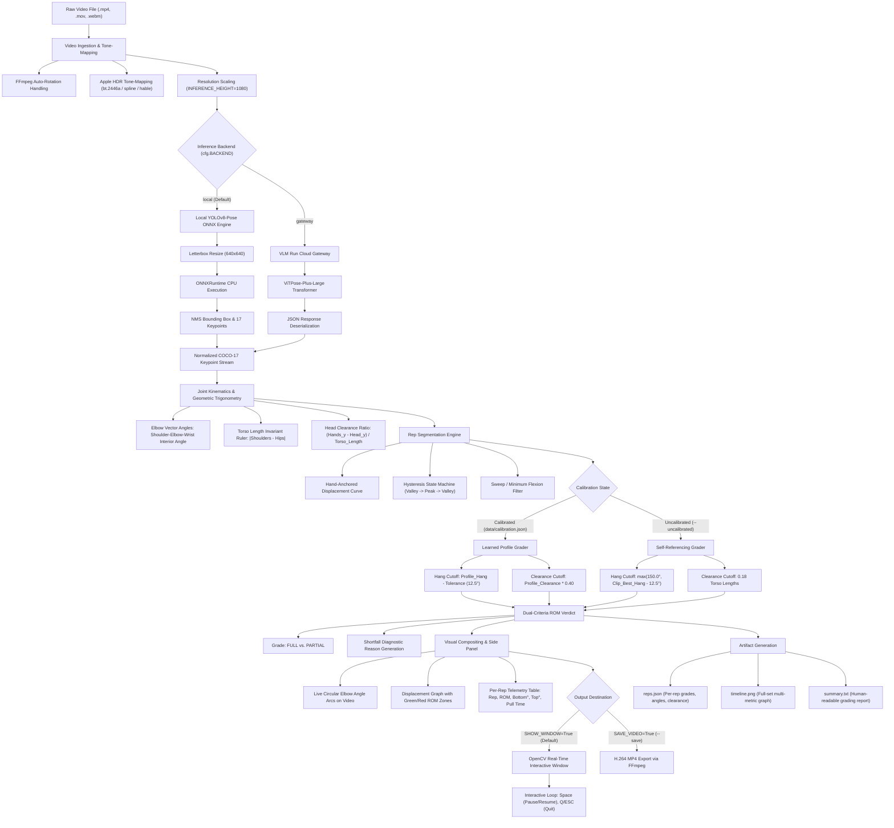

# Motion-Lens: Pull-Ups Biomechanical Range of Motion (ROM) Engine
### End-to-End Technical Architecture, Joint Trigonometry, Calibration & Operational Manual

---

## 1. Executive Summary & Biomechanical Scope

**Motion-Lens: Pull-Ups** is a high-precision computer-vision kinematics engine designed to analyze the **pull-up** exercise from standard pre-recorded video. 

### Biomechanical Profile of the Pull-Up
In human kinesiology, the standard pull-up is defined by:
- **Grip Orientation**: Overhand (**pronated**), where the palms face away from the athlete (anteriorly or toward the rig).
- **Primary Kinematics**: Glenohumeral shoulder adduction and depression in the frontal plane combined with elbow flexion.
- **Muscular Engagement**: Heavy emphasis on the **latissimus dorsi**, **teres major**, **lower trapezius**, and **rhomboids**, with the **brachioradialis** serving as the primary forearm flexor.
- **Biomechanical Gold Standard**:
  1. **Full Dead Hang (Bottom)**: Complete extension of the elbow joints at the bottom of the descent ($\theta_{\text{elbow}} \approx 167^\circ$ in 2D pose space).
  2. **Bar Clearance (Top)**: Pulling until the athlete's head/chin elevates distinctly above the horizontal plane of the hands.

### Core System Objectives
1. **Dual-Criteria Range of Motion (ROM) Grading**: Every rep is graded as **FULL** or **PARTIAL** based on independently measured bottom extension and top bar clearance thresholds.
2. **Diagnostic Failure Attribution**: Identifies precisely *why* a rep failed (`"no full hang at the bottom"`, `"head did not clear the bar"`, or `"short at both ends"`).
3. **Athlete Calibration Protocol (`calibrate.py`)**: Accounts for individual anatomical differences and camera angles by measuring a full-ROM reference set, rather than imposing rigid, uncalibrated static cutoffs.
4. **Live Circular Elbow Arcs**: Renders geometric angular arcs and degree telemetry directly over the athlete's arms in the live video feed.
5. **Real-Time Interactive Window**: Streams the side-by-side video and ROM telemetry table at native framerates via `cv2.imshow` without requiring disk writes.

---

## 2. End-to-End Architectural Pipeline



---

## 3. Mathematical & Kinematic Formulations

### 3.1 2D Vector Interior Elbow Angle Trigonometry
For each arm (left and right), three joint coordinates are extracted per frame:
- $A = (x_{\text{shoulder}}, y_{\text{shoulder}})$
- $B = (x_{\text{elbow}}, y_{\text{elbow}})$ (the vertex)
- $C = (x_{\text{wrist}}, y_{\text{wrist}})$

Because videos may have non-square display aspect ratios, horizontal coordinates are scaled by aspect ratio $\alpha = \frac{W}{H}$ to prevent geometric angular distortion:
$$x' = x \cdot \alpha, \quad y' = y$$

Define the directional vectors radiating from the elbow vertex $B$:
$$\vec{u} = A' - B' = \begin{bmatrix} x_{\text{shoulder}}' - x_{\text{elbow}}' \\ y_{\text{shoulder}}' - y_{\text{elbow}}' \end{bmatrix}, \quad \vec{v} = C' - B' = \begin{bmatrix} x_{\text{wrist}}' - x_{\text{elbow}}' \\ y_{\text{wrist}}' - y_{\text{elbow}}' \end{bmatrix}$$

The interior angle $\theta$ (in degrees) is derived via the Euclidean inner product:
$$\theta = \arccos\left( \frac{\vec{u} \cdot \vec{v}}{\|\vec{u}\|_2 \, \|\vec{v}\|_2} \right) \times \frac{180^\circ}{\pi}$$

```
        A (Shoulder)
         \
          \   u
           \
            B (Elbow) ─── v ─── C (Wrist)
               θ (Interior Angle)
```

- When the arm is completely straight: $\theta \rightarrow 180^\circ$.
- When the arm is fully flexed at the top of a pull: $\theta \rightarrow 35^\circ - 45^\circ$.
- The composite elbow angle $\bar{\theta}(t)$ per frame is the mean across all visible arms:
  $$\bar{\theta}(t) = \frac{1}{|K_{\text{visible}}|} \sum_{a \in K_{\text{visible}}} \theta_a(t)$$

---

### 3.2 Torso Length as an Invariant Physical Ruler
Pixel measurements vary dramatically depending on whether an athlete is close to the camera or far away. To eliminate camera distance as a variable, Motion-Lens uses the athlete's **torso length** $L_{\text{torso}}(t)$ as a self-normalizing ruler:

$$L_{\text{torso}}(t) = \left| \frac{y_{\text{left\_hip}}(t) + y_{\text{right\_hip}}(t)}{2} - \frac{y_{\text{left\_shoulder}}(t) + y_{\text{right\_shoulder}}(t)}{2} \right|$$

#### Head Clearance Calculation
The athlete's head vertical coordinate $y_{\text{head}}(t)$ is computed by taking a confidence-weighted average of facial keypoints (nose, eyes, and ears). When viewed from the rear, the ears dominate; when viewed from the front, the eyes and nose dominate.

The head clearance over the bar $C(t)$ (expressed in **torso lengths**) is:
$$C(t) = \frac{y_{\text{hands}}(t) - y_{\text{head}}(t)}{L_{\text{torso}}(t)}$$
- $C(t) < 0$: Head is below the bar (dead hang).
- $C(t) \approx 0.10$: Chin is level with the bar.
- $C(t) \ge 0.18$: Head and chin clearly surpass the bar.

---

### 3.3 Extreme Sampling with Median Window Filtering
Turnaround points (valleys and peaks) are vulnerable to single-frame detector fluctuations. Instead of sampling a single instantaneous frame, Motion-Lens computes the median across a 5-frame temporal window centered on each extreme:

$$\theta_{\text{hang}} = \text{median}\left( \{\bar{\theta}(i)\}_{i=v-2}^{v+2} \right), \quad C_{\text{peak}} = \text{median}\left( \{C(i)\}_{i=p-2}^{p+2} \right)$$
This ensures that a single noisy frame cannot cause a full rep to be marked partial or vice-versa.

---

### 3.4 Dual-Criteria ROM Verdict Matrix

Every repetition $k$ is judged against two independent mechanical conditions:

$$\text{Condition 1 (Bottom Hang)}: \quad \theta_{\text{hang}}^{(k)} \ge \theta_{\text{required}}$$
$$\text{Condition 2 (Top Clearance)}: \quad C_{\text{peak}}^{(k)} \ge C_{\text{required}}$$

| Bottom ($\theta_{\text{hang}}$) | Top ($C_{\text{peak}}$) | Verdict | Diagnostic Reason |
|:---:|:---:|:---:|---|
| ✅ Pass | ✅ Pass | **FULL** | `"full range"` |
| ❌ Fail | ✅ Pass | **PARTIAL** | `"no full hang at the bottom"` |
| ✅ Pass | ❌ Fail | **PARTIAL** | `"head did not clear the bar"` |
| ❌ Fail | ❌ Fail | **PARTIAL** | `"short at both ends"` |

---

## 4. Athlete Calibration Engine (`calibrate.py`)

### 4.1 Why Static Thresholds Fail
In computer vision pose estimation, neural networks place the `shoulder` keypoint on the **lateral deltoid** muscle bulk rather than at the anatomical center of the glenohumeral joint. Consequently, when a human athlete locks their arms into a complete dead hang, the 2D keypoint angle measures **$\approx 167^\circ$**, not $180^\circ$.

Furthermore, body morphology (arm length, lat width, shoulder flexibility) and camera mounting height shift this angle between athletes. Imposing an arbitrary static cutoff (e.g. $175^\circ$) would falsely fail athletes who are demonstrably in a complete dead hang.

### 4.2 The Calibration Protocol
By filming a reference set of full-ROM repetitions and running `calibrate.py`, Motion-Lens builds an athlete-specific profile saved to `data/calibration.json`:

```bash
cd pull_ups
../.venv/bin/python calibrate.py data/input/my_full_set.mp4
```

The calibration engine measures three core statistical distributions across all reference reps:
1. **Hang Angle ($\theta_{\text{hang}}$)**: Mean, min, max, and spread.
2. **Top Angle ($\theta_{\text{top}}$)**: Elbow angle when fully flexed at the peak.
3. **Head Clearance ($C$)**: Clearance reached at the peak in torso lengths.

### 4.3 Learned Cutoffs Applied to Future Sets
Once `calibration.json` exists, subsequent runs automatically load it:

1. **Required Hang Angle**:
   $$\theta_{\text{required}} = \text{Mean}(\theta_{\text{hang}}) - \theta_{\text{tolerance}} \quad (\theta_{\text{tolerance}} = 12.5^\circ)$$
   *Example: If an athlete's full hang averages $167.5^\circ$, full extension is awarded for any rep reaching $\ge 155.0^\circ$.*
2. **Required Clearance**:
   $$C_{\text{required}} = \text{Mean}(C) \times 0.40$$
   *Demands at least 40% of the athlete's reference bar clearance.*
3. **Elbow Sweep Gate ($\Delta \theta_{\text{sweep}}$)**:
   $$\Delta \theta_{\text{sweep}} = \text{Mean}(\theta_{\text{hang}}) - \text{Mean}(\theta_{\text{top}})$$
   $$\theta_{\text{min\_flexion}} = \Delta \theta_{\text{sweep}} \times 0.35$$
   *Filters out micro-bounces and false twitches: a movement must flex the elbow by at least 35% of a full pull to be recognized as a rep attempt.*

---

## 5. Telemetry HUD & Circular Elbow Arcs

Motion-Lens composites an interactive HUD that overlays kinematic data directly onto the video feed:

```
┌──────────────────────────────────────┬──────────────────────────────────────┐
│  [Video with Skeleton Overlay]       │ Reps: 6            Avg pull: 1.10s   │
│                                      │ Full ROM: 3 / 6          Elbow: 46°  │
│        \        /                    │                                      │
│         O (Arc)O (Arc)               │         Vertical Displacement        │
│          \    /                      │   clears bar ── ── ── ── ── ── ── ── │
│           \  /                       │              /\    /\   ..            │
│            \/                        │             /  \  /  \ /  \           │
│                                      │   dead hang ── ── ── ── ── ── ── ── │
│                                      │                                      │
│                                      │ REP   ROM     BOTTOM   TOP   PULL    │
│                                      │  1    FULL     168°    42°   1.03s   │
│                                      │  2    FULL     164°    40°   1.03s   │
│                                      │  3   PARTIAL   160°    95°     -     │
│                                      │  4   PARTIAL   156°    72°     -     │
│                                      │  5    FULL     156°    38°   1.23s   │
│                                      │  6   PARTIAL   124°    44°     -     │
└──────────────────────────────────────┴──────────────────────────────────────┘
            Video Stream (1280x720)                 ROM Panel (1280x720)
```

### 5.1 Circular Elbow Arcs Overlay
In `src/render.py`, circular arcs are dynamically drawn over each elbow joint:
- Center: Keypoint coordinate of the elbow.
- Sweep: Spans the angular sector from vector $\vec{u}$ (elbow $\rightarrow$ shoulder) to vector $\vec{v}$ (elbow $\rightarrow$ wrist).
- Color: Neon cyan (`cfg.ELBOW_ARC_COLOR = (240, 200, 40)` in BGR).
- Radius: Scaled proportionally with video resolution (`cfg.ELBOW_ARC_RADIUS = 30px` at 720p).

### 5.2 Side Panel Table Specifications
- **FULL reps**: Displayed in vibrant green (`#51cf66`). Concentric pull time is reported.
- **PARTIAL reps**: Displayed in coral red (`#ff6b6b`). The specific end that failed is highlighted in red (e.g. top angle `95°` in red). Pull time is withheld (`-`) because incomplete reps are not awarded a valid pull time.

---

## 6. Real-Time Interactive GUI Window

The real-time interactive window allows immediate visual inspection of pre-recorded sets without writing large `.mp4` video files to disk.

### Playback Controls
| Keybinding | Action | Description |
|:---:|:---:|---|
| **`Space`** | **Pause / Resume** | Pauses playback at the current frame, allowing inspection of keypoint alignment and angles. |
| **`Q`** | **Quit / Exit** | Closes the GUI window and cleanly completes processing. |
| **`ESC`** | **Quit / Exit** | Same as `Q`. |

### Performance Optimization
- Native FPS pacing matches source video framerate (e.g. 30 FPS = 33.3ms delay per frame).
- Window dimensions automatically scale proportionally to standard desktop displays (`WINDOW_WIDTH = 1280`).

---

## 7. Exhaustive Configuration Reference (`config.py`)

All operational constants in `pull_ups/config.py` are documented below:

| Parameter | Type | Default | Description |
|---|:---:|:---:|---|
| `INPUT` | `Path` | `data/input` | Input video file or directory containing videos to process. |
| `VIDEO_EXTENSIONS` | `tuple` | `(".mov", ".mp4", ...)` | Recognized video container extensions. |
| `INFERENCE_HEIGHT` | `int` | `1080` | Frame height in pixels passed to the pose estimation model. |
| `EXPORT_HEIGHT` | `int` | `1080` | Frame height in pixels of the rendered composite canvas. |
| `TRIM_SECONDS` | `float \| None` | `None` | Truncates analysis to first $N$ seconds when set. |
| `TONEMAP` | `str` | `"auto"` | Tone-mapping for Apple HDR (HLG): `"auto"`, `"off"`, or `"force"`. |
| `TONEMAP_ALGORITHM` | `str` | `"bt.2446a"` | Algorithm: `"bt.2446a"`, `"spline"`, or `"hable"`. |
| `BACKEND` | `str` | `"local"` | Inference backend: `"local"` (YOLOv8 ONNX) or `"gateway"` (ViTPose). |
| `LOCAL_MODEL_PATH` | `Path` | `models/yolov8n-pose.onnx`| Path to local ONNX pose model weights. |
| `SHOW_WINDOW` | `bool` | `True` | Opens real-time interactive OpenCV display window. |
| `SAVE_VIDEO` | `bool` | `False` | When `True`, renders and saves H.264 `.mp4` to `data/output/`. |
| `WINDOW_WIDTH` | `int` | `1280` | Width of the real-time display window in pixels. |
| `GRADE_ROM` | `bool` | `True` | Enables the range-of-motion grading engine. |
| `CALIBRATION_PROFILE` | `Path` | `data/calibration.json` | Path to the saved calibration profile JSON file. |
| `USE_CALIBRATION` | `bool` | `True` | Set `False` via `--uncalibrated` to disable learned profile. |
| `CALIBRATION_VIDEO` | `Path` | `data/input/pull_ups_full_rom.mov` | Default video used by `calibrate.py`. |
| `ARM_JOINTS` | `tuple` | `(("l_sh", "l_el", "l_wr"), ...)` | Keypoint triplets defining left and right arm angles. |
| `ROM_HANG_TOLERANCE_DEGREES`| `float` | `12.5` | Allowed deficit from reference hang angle (degrees). |
| `ROM_CLEARANCE_FRACTION` | `float` | `0.40` | Required fraction of reference clip's head clearance. |
| `ROM_HANG_ELBOW_DEGREES` | `float` | `150.0` | Minimum hang elbow angle fallback when uncalibrated. |
| `ROM_CLEARANCE_TORSO_FRACTION`| `float`| `0.18` | Minimum head clearance (in torso lengths) when uncalibrated. |
| `ROM_SAMPLE_FRAMES` | `int` | `5` | Window size for median filter at valleys and peaks. |
| `ELBOW_ARC_RADIUS` | `int` | `30` | Radius in pixels of circular elbow angle arcs at 720p. |
| `ELBOW_ARC_COLOR` | `tuple` | `(240, 200, 40)` | BGR color of the elbow angle arcs (cyan). |
| `REP_METRIC` | `str` | `"moving"` | Reported pull timing span: `"moving"`, `"ascent"`, or `"total"`. |
| `REP_LABEL` | `str` | `"Pull-ups"` | Header label displayed on the HUD panel. |

---

## 8. Command-Line Interface (CLI) Manual

### Running Video Analysis (`main.py`)
```bash
cd pull_ups
../.venv/bin/python main.py [OPTIONS] [CLIP_OR_DIR ...]
```

| Flag | Argument | Default | Description |
|---|:---:|:---:|---|
| `CLIP \| DIR` | Positional path | `data/input` | Specific clip or entire directory of clips to process. |
| `--show` | None | `True` | Displays interactive real-time window playback. |
| `--no-show` | None | - | Runs headless without opening a GUI window. |
| `--save` | None | `False` | Renders and saves output MP4 video to `data/output/`. |
| `--no-save` | None | `True` | Avoids heavy video file exports. |
| `--local` | None | `True` | Uses local offline YOLOv8-pose engine. |
| `--gateway` | None | - | Uses cloud VLM Run gateway. |
| `--uncalibrated` | None | - | Bypasses `calibration.json`; grades clip against itself. |
| `--profile` | `PATH` | `calibration.json`| Specifies a custom calibration profile JSON file. |
| `--hang-tolerance` | `DEG` | `12.5` | Overrides bottom hang tolerance degrees. |
| `--metric` | `ascent\|moving\|total` | `moving` | Sets the pull duration measurement span. |
| `--height` | `PX` or `full` | `1080` | Overrides export resolution height. |
| `--trim` | `SECONDS` | `None` | Truncates analysis to first $N$ seconds. |
| `--fresh` | None | - | Ignores cached pose estimations and re-runs model. |

### Running Calibration (`calibrate.py`)
```bash
cd pull_ups
../.venv/bin/python calibrate.py [VIDEO_PATH]
```
- Analyses the reference clip (where all reps are known to be full range of motion).
- Calculates mean and spread for hang angle, peak angle, and head clearance.
- Writes the result to `data/calibration.json`.

---

## 9. Output Directory & Data Schemas

Every run generates a timestamped folder under `pull_ups/data/output/YYYYMMDD-HHMMSS/`:

```
data/output/20261027-225755/
├── timeline.png             # Multi-panel graph: displacement, elbow angles & clearance
├── reps.json                # Complete machine-readable telemetry and rep grades
├── summary.txt              # Formatted human-readable report
├── run.json                 # Provenance, calibration parameters, and config snapshot
└── <clip>_pull_ups.mp4      # (Optional: Only present when --save is passed)
```

### 9.1 `reps.json` Telemetry Schema
```json
{
  "summary": {
    "total_reps": 6,
    "full_rom_reps": 3,
    "partial_reps": 3,
    "mean_pull_seconds": 1.10,
    "verdict": "rep 3, 4, 6: head did not clear the bar"
  },
  "reps": [
    {
      "number": 1,
      "rom": {
        "complete": true,
        "hang_degrees": 168.2,
        "peak_degrees": 42.1,
        "clearance_torso_lengths": 0.372,
        "hang_required_degrees": 155.0,
        "clearance_required": 0.168,
        "bottom_ok": true,
        "top_ok": true,
        "reason": "full range"
      },
      "pull_seconds": 1.03,
      "onset_time": 0.0,
      "peak_time": 1.03,
      "valley_time": 0.0
    }
  ]
}
```

---

## 10. Recording & Dataset Guidelines

For optimal pull-up tracking:
1. **Camera Angle**: Directly in front or directly behind the athlete. Posterior (behind) angles provide exceptional visibility of elbow extension and head clearance relative to the bar.
2. **Camera Level**: Position camera at shoulder height. High downward-angled camera placements artificially compress vertical head clearance.
3. **Bar Framing**: Ensure the bar is completely visible so the wrists can establish stable spatial anchors.
4. **Recommended Datasets**:
   - **[RepCount Benchmark](https://github.com/Yuxuan-Chen-99/RepCount)**: Pull-up sequences across diverse athletes.
   - **[Countix Dataset](https://deepmind.google/discover/blog/countix-a-repetition-counting-dataset/)**: Real-world exercise rep videos.
   - **Pexels & Wikimedia Commons**: High-definition CC0 / CC-BY fitness videos.
